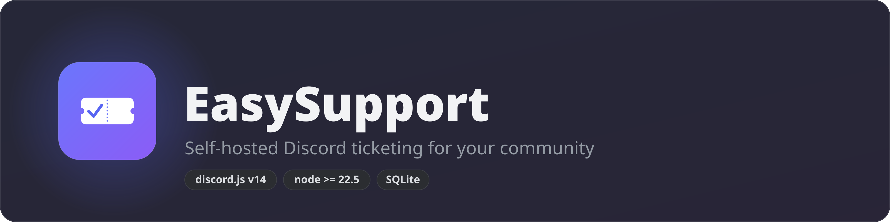
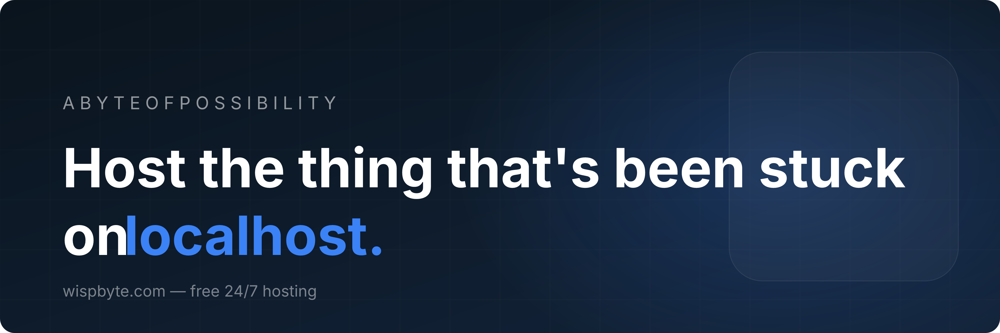
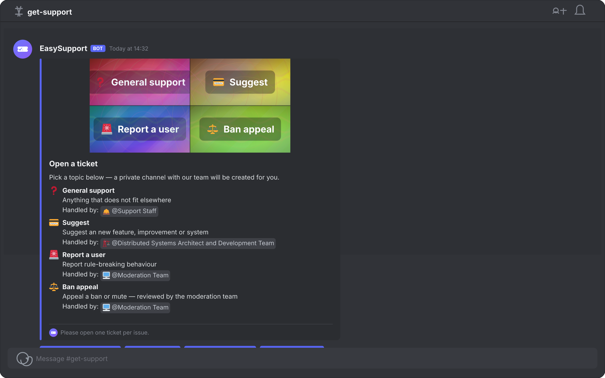
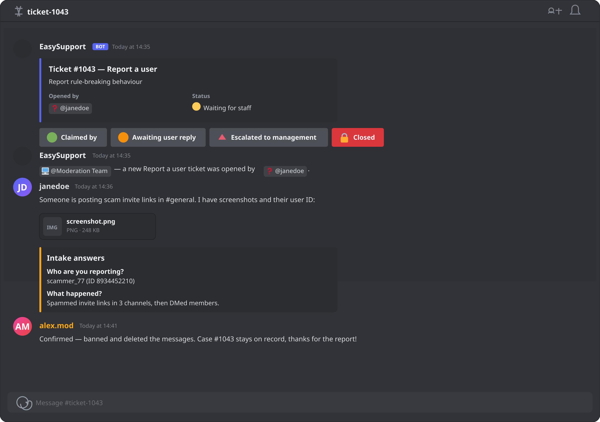
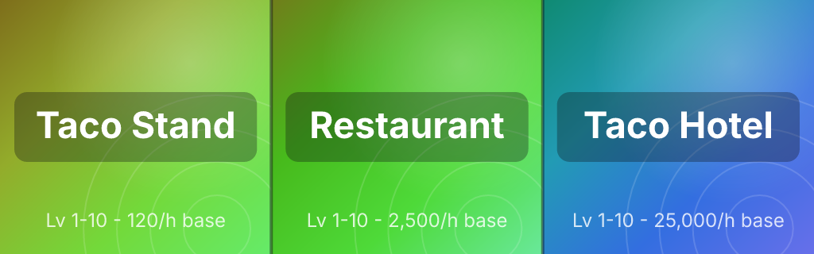
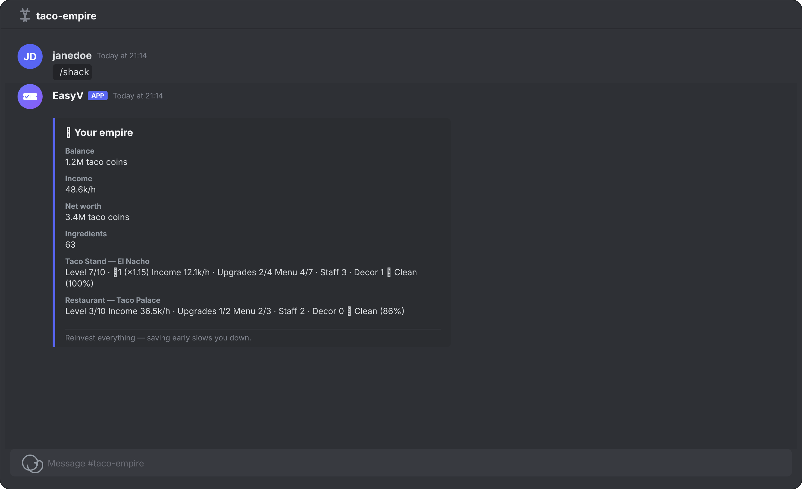
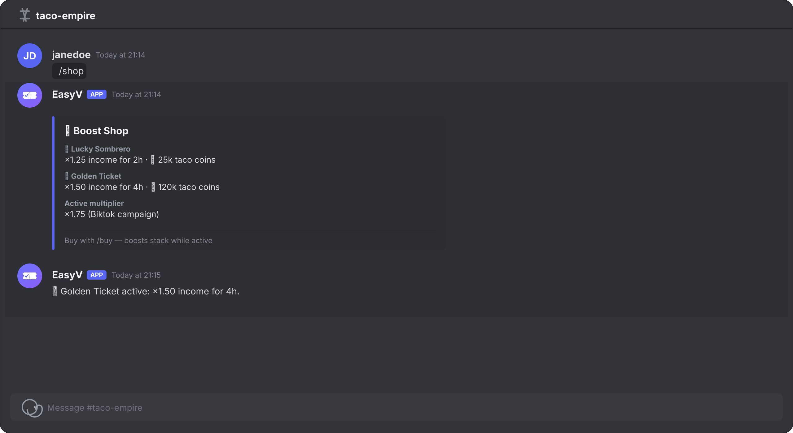
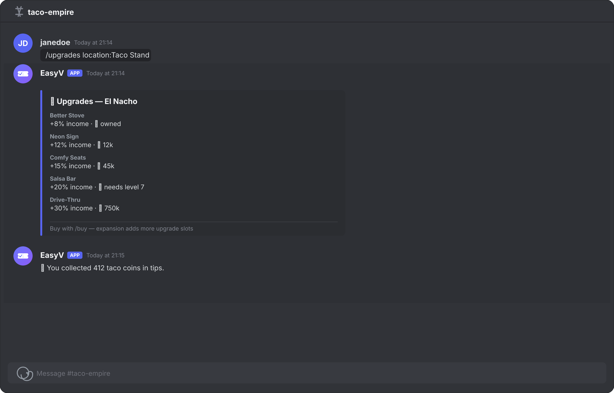
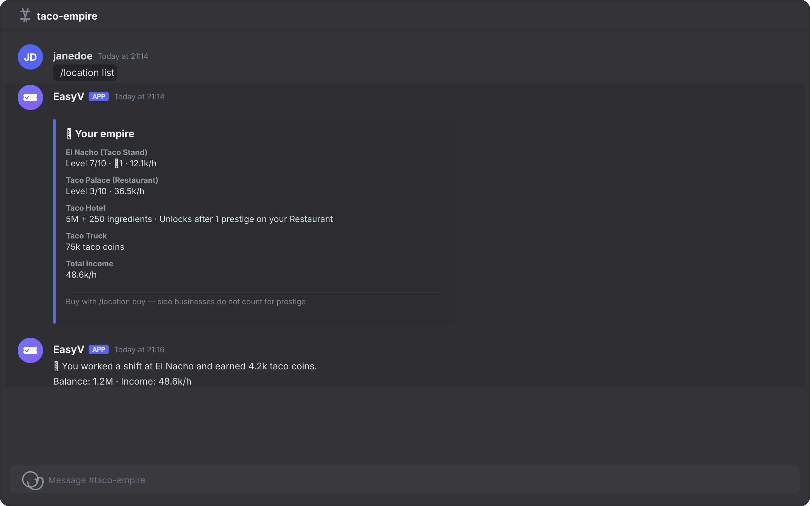

<div align="center">





<a href="https://wispbyte.com"></a>


**Private support tickets, staff workflows, transcripts and ratings — driven by one config file.**

<p>
  
  
  
  
  
  <a href="https://github.com/Marcel1kub1/EasySupport/pulls"></a>
  
  
</p>

</div>

---

## ✨ Features

- 🎫 **One-click tickets** — `/panel` posts a button per category; members get a private channel instantly
- 📋 **Intake questions** — ask up to 5 questions in a popup before the channel is created
- 🧩 **Everything in one panel** — art, status, intake answers and all status buttons live in a single message
- 🎨 **Generated category art** — every ticket channel and the public panel get a banner rendered with `@resvg/resvg-js`, showing the **category name and emoji** on a palette unique to that category (deterministic, cached in `data/art/`)
- 🧭 **Config-driven statuses** — every status in `src/categories.js` becomes a control-panel button (claim, pending, escalate, close)
- 🎮 **Taco Empire mini-game** — a full tycoon loop (`/work`, `/tips`, `/daily`, `/menu`, `/hire`, …) with levels, upgrades, cleanliness and prestige
- 🔒 **Private channels** — only the opener and the handling role can see the ticket
- 📄 **Transcripts** — a TXT + HTML transcript is generated when a ticket closes
- ⭐ **Rating prompt** — members rate the support 1–5 by DM after close
- 📝 **Audit log** — every action is logged to your log channel
- 🗄️ **SQLite, zero native deps** — `node:sqlite` ships with Node, so `npm install` downloads nothing to compile
- ⚙️ **One-file config** — roles by name (`'Moderation Team'`) or by ID, everything else is optional

## 🖼️ Preview

**The ticket panel** (`/panel` — one button per category, handled-by pills per field):



**Inside a ticket** (status buttons, staff ping, intake answers):



## 🌮 Taco Empire — the built-in tycoon game

A chill, no-PvP business sim that lives in the same bot: start with a free taco
stand, reinvest everything, grow into restaurants and hotels. No robbing, no
gambling — just numbers going up.



**Core loop:** `/work` for cash → `/buy` upgrades → `/menu` high-value items →
`/hire` staff for passive income → keep the shack `/clean` so customers stay.

**`/shack` — your empire at a glance:**



**`/shop` — the boost store, and buying a boost:**



**`/upgrades` — the reinvestment ladder, and `/tips` payouts:**



**`/location list` — the three business lines, and a `/work` shift:**



| Command | What it does |
|---|---|
| `/found <name>` | Name your shack (first run also grants the free stand) |
| `/work` | Cook tacos for cash — main earner, 1h cooldown, random Happy Hour doubles |
| `/tips` | Collect the tip jar (8 min) — pays less when the shack is dirty |
| `/daily` | Streak bonus, up to 7× |
| `/clean` | Scrub the shack — dirt cuts income and tips |
| `/mine` | Gather ingredients for restaurants, hotels and recipes |
| `/shack` | Stats: balance, income, cleanliness, menu, staff, net worth |
| `/cooldowns` | Which actions are ready |
| `/upgrades` | Browse the upgrade ladder (+% income each) |
| `/buy <upgrade\|boost>` | Buy equipment or a temporary boost |
| `/shop` | Browse boosts (Lucky Sombrero, Golden Ticket) |
| `/menu view\|set` | Fill menu slots — empty slots silently cap your income |
| `/hire <type> <name>` | Hire chefs, line cooks and janitors for passive income |
| `/employees list\|train` | View staff; train them after your first prestige |
| `/location list\|buy` | Browse and buy businesses (restaurant, hotel, taco truck) |
| `/prestige` | Reset a maxed business to level 1 for a stacking multiplier |
| `/advertise` | Biktok campaign: ×1.75 income for 3h (unlocks with prestige) |
| `/expand` | More upgrade slots for a business |
| `/hq` | Headquarters: global income upgrades for every business |
| `/decorations` | Browse cosmetics with small income bonuses |
| `/tasks view\|claim` | Three daily tasks (work shifts, tips, mining…) with cash rewards |
| `/achievements` | Long-term goals — badges unlock automatically as you play |
| `/badge view` | Your badge collection |
| `/coupons` · `/redeem <code>` | Active coupon codes and redemption |
| `/rewards` | Your streak, claimed tasks and redeemed coupons |
| `/remind <action>` | Get pinged when an action is ready again |
| `/rushhour info` · `/event info` | When the 2× income windows run |

**Systems:** per-business 10-level ladders with exponential upgrade costs ·
quadratic income growth · menu slots that unlock per level · employees with
wages vs. bonuses · cleanliness decay with janitors that slow it · **prestige**
for stacking multipliers · **ownership synergy** (+10% on all income per extra
business line) · expandable upgrade slots · HQ multipliers · decorations ·
boosts that stack · Happy Hour and Lunch Rush events.

**Progression:** free taco stand → **Restaurant** (500k + 50 ingredients, after
your first taco prestige) → **Taco Hotel** (5M + 250 ingredients, after a
restaurant prestige), plus the **Taco Truck** side business at level 3.

**Coming next** (roadmap): franchises & leaderboards · the Sauce Market, Kitchen recipes and gambling.

## 📋 Requirements

- **Node.js 22.5+** (hosted on your server — nothing needs to run locally).
  SQLite ships built into Node (`node:sqlite`). Panel art is rasterized with
  `@resvg/resvg-js`, which downloads a **prebuilt binary** on `npm install`
  (no compiler toolchain needed); if it is ever unavailable the bot falls back
  to a built-in procedural renderer, so tickets still get an image.
- A Discord application + bot token ([Developer Portal](https://discord.com/developers/applications))
- On the server: permissions **Manage Channels** and **Manage Roles**

## 🚀 Setup

### 1. Create the application

1. Developer Portal → **New Application**.
2. **Bot** → **Reset Token** → copy it.
3. Under **Bot → Privileged Gateway Intents**, enable **Server Members Intent**
   and **Message Content Intent** (the bot needs message content to build transcripts).
4. **OAuth2 → URL Generator**: scopes `bot` + `applications.commands`; bot
   permissions: `Manage Channels`, `Manage Roles`, `Send Messages`,
   `Attach Files`, `Embed Links`, `Read Message History`.

### 2. Configure the bot

```bash
cp .env.example .env
```

```env
DISCORD_TOKEN=your-bot-token
CLIENT_ID=your-application-id        # OAuth2 → Application ID
GUILD_ID=your-dev-guild-id           # optional; commands register instantly per-guild
```

### 3. Install and register commands

```bash
npm install
npm run deploy        # registers /setup and /panel
npm start             # boots the bot
```

`npm run deploy` loads whatever is in `src/commands/` and **deletes any command
on Discord that is no longer in the system** (in both the guild and global
scope), so the command list always matches the current build. Restart the
Discord client if the list looks cached.

### 4. Configure in Discord

```
/setup staff_role:@Support log_channel:#ticket-logs category:Support max_open:3
/panel                # posts the panel; members click a button to open a ticket
```

That's it — a member clicking a panel button gets their own private channel
with a status button for every status defined in `src/categories.js`
(Claim, Pending, Escalate, Close, …) for staff to use.

## 🗂️ Project layout

```
src/
├── index.js                 client bootstrap, auto-loads commands + events
├── config.js                validated env config
├── art.js                   SVG art generator: category + panel banners with names
├── categories.js            CENTRAL CONFIG: categories, questions, statuses
├── db.js                    SQLite schema + repository functions
├── transcripts.js           TXT + HTML transcript generation
├── commands/setup.js        /setup — per-guild configuration
├── commands/panel.js        /panel — post the ticket panel
└── events/
    ├── interactionCreate.js panel buttons, intake modals, status flows, rating
    └── messageCreate.js     automated interaction logging

assets/
├── fonts/                   Inter (OFL) bundled for banner text rendering
├── emoji/                   Twemoji SVGs for the emojis used in categories.js
└── economy-banner.png       Taco Empire preview image

src/economy/
├── config.js                ALL game balance: locations, ladders, employees, market
├── engine.js                PURE math: income, payouts, decay, prestige, synergy
├── db.js                    schema + repository (dependency-injected for tests)
├── instance.js              the repository bound to the shared bot database
├── util.js                  cooldowns, location picker and formatting helpers
├── format.js                money/rate formatting
└── commands/                found work tips clean daily shack cooldowns upgrades
                             buy shop menu employees hire mine location prestige
                             advertise expand hq decorations
```

## 🖥️ Hosting on a server

The template writes its database to `data/tickets.db`, generated panel art to
`data/art/`, downloaded emoji SVGs to `data/emoji/` and transcripts to
`transcripts/`. For production:

- Run under **systemd** or **PM2** so it restarts on reboot:

  ```ini
  # /etc/systemd/system/ticketbot.service
  [Service]
  WorkingDirectory=/opt/ticketbot
  ExecStart=/usr/bin/node src/index.js
  Restart=always
  EnvironmentFile=/opt/ticketbot/.env
  ```

- Back up `data/` and `transcripts/` on a schedule (cron + restic/borg).
- When you outgrow SQLite, swap the statements in `src/db.js` for PostgreSQL —
  the schema is already relational (see DESIGN.md §2.3).
- Keep `.env` out of git (it's in `.gitignore`) and never commit the token.

## 🧪 Tests

```bash
npm test        # 105 tests: engine math, db integration, command smoke tests, loader
```

The economy engine is a **pure module** — every payout, decay and multiplier is
unit-tested against the config, and every command is executed end-to-end against
a throwaway database in `src/economy/commands.smoke.test.js`.

## 🧩 Extending

Everything about categories and statuses lives in **`src/categories.js`** — the
only file you edit. Every field is optional and defaults are filled in
automatically. Roles are given by **name** (`'Billing Team'`) or by **ID**
(`'123456789012345678'`); an unknown role is skipped with a console warning.

- **Add a category** — one entry. Re-post with `/panel` to render the button:

  ```js
  refunds: {
    label: 'Refunds',
    emoji: '💸',
    staffRole: 'Billing Team',                 // name or ID
    questions: ['What was refunded?', 'When did you pay? (optional)'],  // popup before the channel opens
  },
  ```

  `questions` accepts plain strings (paragraph questions; append
  `(optional)` to make one optional) or full objects:
  `{ label: 'Order ID', style: 'short', required: false }`.

- **Add a status** — one entry in `TICKET_STATUSES`. Each status automatically
  becomes a button on every ticket's control panel, is counted by the
  per-user open-ticket limit (unless `terminal`), and appears in logs:

  ```js
  // ping a high-rank team the moment a ticket is escalated,
  // and grant that role access to the ticket channel
  escalated: {
    label: 'Escalated to management',
    emoji: '🔺',
    staffRole: 'Management',                   // name or ID
  },
  ```

  | Field | Effect |
  |---|---|
  | `label` / `emoji` | Embed text, button label, log text |
  | `staffRole` | Role granted channel access + pinged once on entry |
  | `claimable` | Records which staff member set it |
  | `staffOnly` | Default `true`; `false` lets members press it |
  | `terminal` | Close protocol: confirm → reason → transcript + rating DM → delete |

  Mark the final status (`terminal: true`) — it drives transcript delivery and
  channel deletion. Terminal statuses stop counting toward the open limit and
  freeze message logging. Existing tickets keep the status they already had, so
  re-post `/panel` and treat old panels as stale.

- **Reopen a closed ticket** — the closed ticket row is kept, so a
  `ticket:reopen` status can create a new channel linked to the same record.
- **Regenerate category art** — banners are derived deterministically from the
  category key and label, cache the category name and emoji, and are cached in
  `data/art/`; rename a category (or delete a cached PNG) to get a fresh one.
- **Auto-close inactive tickets** — add a `node-cron` job that closes tickets
  whose last message in `ticket_messages` is older than N days.
- **Staff stats** — query `tickets` for claim time and ratings per staff member.

---

<div align="center">
<sub>Full design rationale, name shortlist and architecture: <a href="./DESIGN.md">DESIGN.md</a></sub>
</div>
